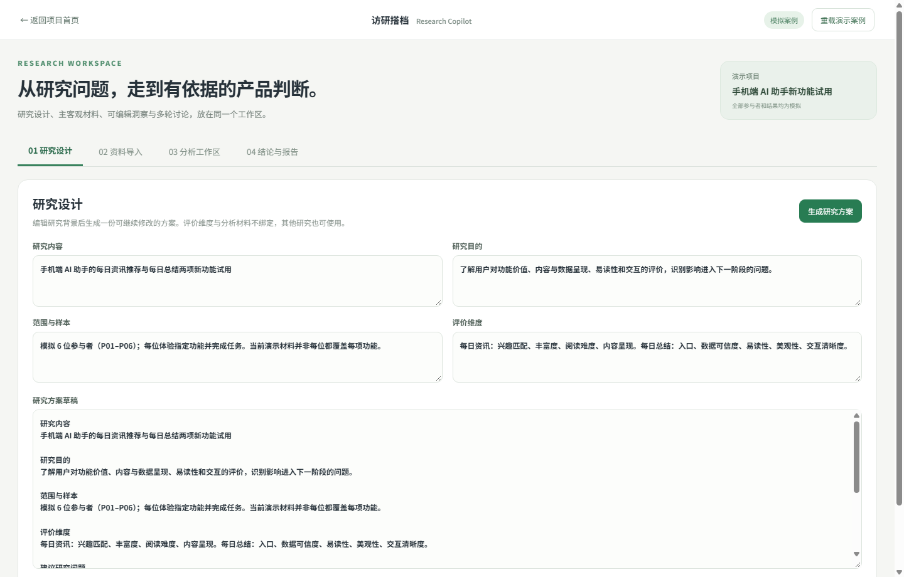
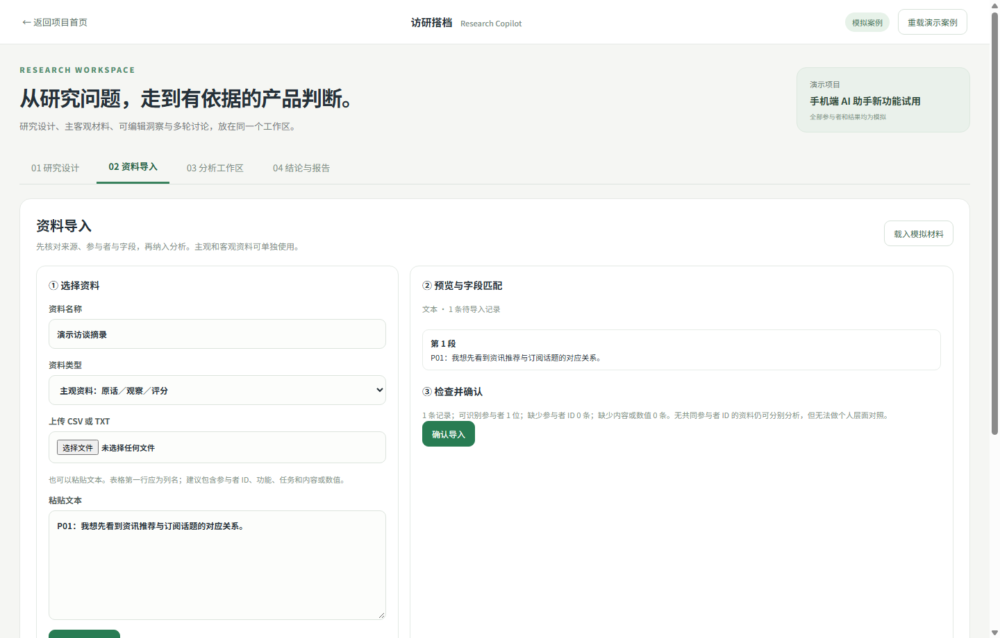
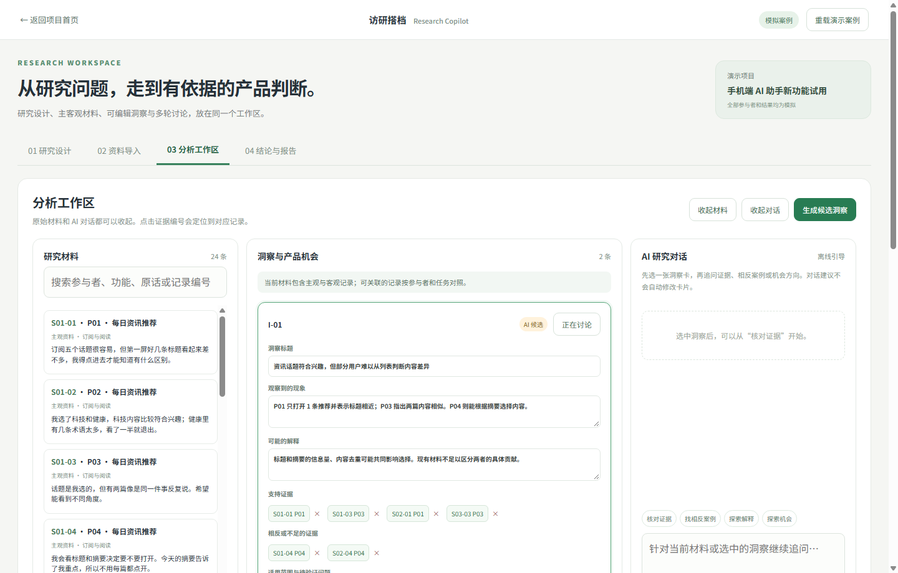

# 访研搭档 Research Copilot

面向用户研究员和产品经理的研究工作台：研究设计、主客观资料导入、证据定位、可编辑洞察、人工确认、候选产品机会与报告。右侧对话可围绕当前洞察和关联记录多轮追问。

**[体验公开离线工作台](https://yyyyskbfxx.github.io/AI-Demo/research.html)** · [阅读完整案例](https://yyyyskbfxx.github.io/AI-Demo/research-project.html)

## 项目背景与目标用户

用户研究员和产品经理在研究中需要同时处理访谈原话、任务观察、评分与研究假设。手工整理容易让洞察脱离原始记录，也容易把主观感受、客观表现和研究者解释混在一起。访研搭档面向需要加快材料整理、但必须保留证据核对和最终判断权的研究者。

## 产品目标与核心流程

输入研究内容、目的、范围样本和评价维度，先得到可编辑研究方案。随后可导入主观材料、客观材料或两者之一，并检查字段映射、参与者 ID 与缺失情况。分析工作区将原话和任务记录连接到候选洞察；研究者可点击证据编号回到原记录，查看支持证据、相反案例与可能解释。与 AI 的多轮对话用于继续探索，但改写需预览，洞察需确认、修改或驳回，产品机会和报告只接收研究者保留的内容。

## Vibe coding 与产品判断

原型先定义研究流程、资料结构、人工复核状态和页面流转，再用原生前端与 Node.js 实现。设计重点是让 AI 帮忙组织候选分析，同时将“证据是否充分”和“是否形成产品机会”的判断留给使用者。当前页面支持材料和对话栏收起、证据定位、洞察卡编辑与本地保存。

## 页面设计与功能

图中材料和参与者均为模拟案例。点击图片可查看完整尺寸；对应的人工复核节点也可在[作品集案例](https://yyyyskbfxx.github.io/AI-Demo/research-project.html)中查看。

### ① 研究设计

- **定义问题：**输入研究内容、目的、范围样本与评价维度。
- **生成方案：**草稿可直接修改，研究者保留最终设计判断。

### ② 资料导入

- **分类导入：**主观和客观资料可单独导入；支持 CSV、TXT 与粘贴文本。
- **入库检查：**预览原始内容、字段映射、参与者 ID 和缺失情况后再确认。

### ③ 分析工作区

- **证据追溯：**原始记录、支持与相反证据可定位核对。
- **人工复核：**AI 候选洞察可编辑，研究者确认后才形成产品机会和报告。

## 体验与材料

打开 `docs/index.html` 可体验离线流程。内置模拟案例有 6 位虚构参与者和 24 条记录；可单独导入 `docs/sample-research/` 中的 CSV。模拟材料与结论不代表真实实习项目或产品效果。工作区状态保存在当前浏览器的本地存储中。

## 运行模型对话

需要 Node.js 18 或更新版本。复制 `.env.example` 为 `.env`，在方舟控制台创建 API Key，并将它填入 `ARK_API_KEY`。当前示例使用已开通的 DeepSeek-V4.1-Flash 经济版；若账号开通其他模型，填写对应模型 ID。运行 `npm start`，打开 `http://127.0.0.1:5196`。使用系统代理的 Node 24 环境可先设置 `NODE_USE_ENV_PROXY=1`。

Key 只在服务端读取。不要提交 `.env`，也不要将真实访谈、个人数据或企业内部资料上传到公开演示。GitHub Pages 只能运行离线页面，不能调用本地 Node API。

## 代码位置

- `docs/research.js`：研究方案、资料导入、证据引用、卡片编辑和对话界面。
- `server.mjs`：静态文件服务和模型对话接口。
- `docs/sample-research/`：可公开的模拟 CSV。
